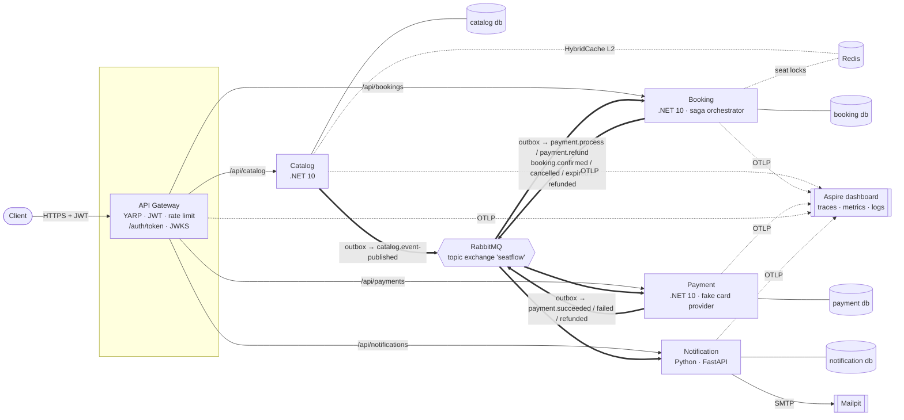
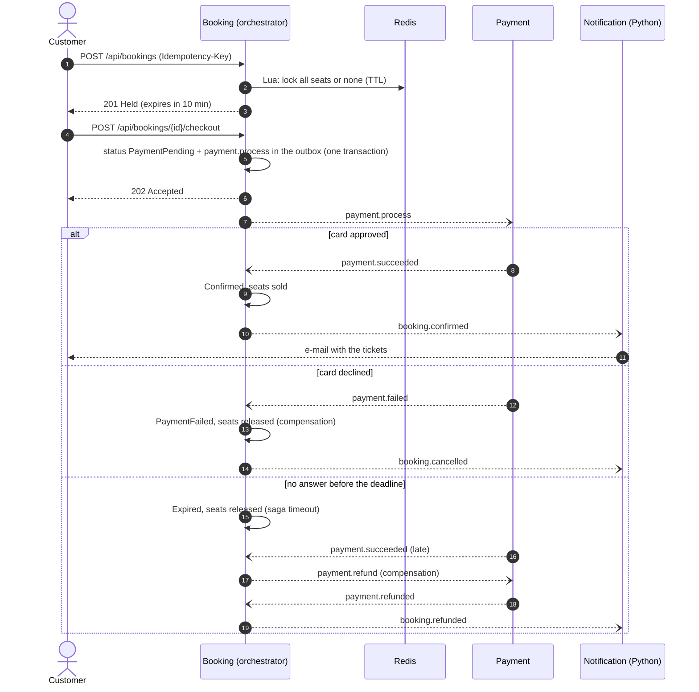
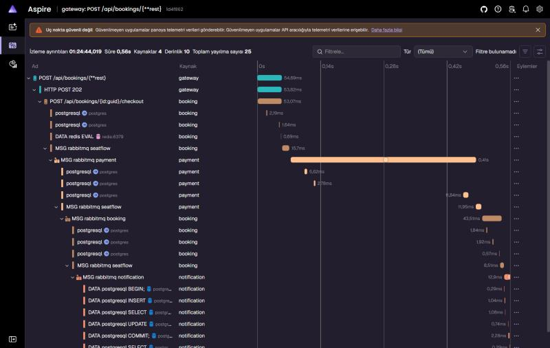

# SeatFlow

[](https://github.com/abdurrahmanyesilyurt/seatflow/actions/workflows/ci.yml)

**Event-driven seat reservation on .NET 10 microservices.** Customers hold seats, pay, and get their tickets by e-mail.
The interesting part is under the hood: it never sells a seat twice, never charges twice, and never loses a message,
even when requests race, brokers redeliver and payments arrive late.

| | |
|---|---|
| **Services** | Catalog, Booking, Payment (ASP.NET Core 10, EF Core 10), Notification (Python 3.13, FastAPI), YARP API gateway |
| **Messaging** | RabbitMQ 4 quorum queues, transactional outbox, idempotent inbox, dead-letter queues |
| **Data** | PostgreSQL 18 (one database and login per service), Redis 8 (seat locks, HybridCache) |
| **Patterns** | Orchestrated saga with compensation, idempotency keys, optimistic concurrency, event-carried state transfer |
| **Security** | RS256 JWT issued by the gateway, verified by every service via JWKS; per-user rate limiting; chiseled non-root images |
| **Ops** | OpenTelemetry traces/metrics/logs end to end (including the Python service), Docker Compose, Kubernetes on kind |
| **Quality** | 30 .NET tests (xUnit v3 + Testcontainers against real PostgreSQL/Redis/RabbitMQ), 9 pytest tests, CI on GitHub Actions |

## Architecture



Each service owns its data. Services never call each other synchronously: Booking keeps its own copy of events, seats
and prices (fed by `catalog.event-published`), so holding a seat works even if Catalog is down.

### The booking saga



## Run it

Requirements: Docker Desktop (or any Docker with Compose v2). Nothing else; everything builds inside containers.

```bash
docker compose up --build --wait
```

Then run the scripted demo (PowerShell on Windows, Bash elsewhere; the Bash one needs `curl` and `jq`):

```powershell
./scripts/demo.ps1 -Scenario all
```

```bash
scripts/demo.sh all
```

```text
==> Alice holds A-1-1, A-1-2
    OK  201 Created, booking 6cb28754-…, total 2400.00 TRY, hold expires …
==> Alice's client retries the same request (network blip) with the same Idempotency-Key
    OK  200 OK, same booking id, Idempotent-Replayed: true (no second booking)
==> Bob tries to grab A-1-1
    OK  409 Conflict, unavailable: A-1-1
==> Alice checks out with tok_visa (booking -> outbox -> payment.process -> fake provider -> payment.succeeded)
    OK  booking Confirmed
    OK  e-mail delivered: 'Your tickets for Jazz Under the Stars (booking 6cb28754)'
==> 20 different users try to hold VIP-1-1 at the same moment
    OK  exactly one hold succeeded, 19 got 409
==> Carol holds B-1-1 and pays with tok_declined
    OK  compensation: B-1-1 is Available again
==> Dave holds B-1-1 and pays with tok_slow (provider answers after the 15 s payment deadline)
    OK  saga timeout fired: Expired; the seat went back on sale
    OK  late payment.succeeded -> payment.refund -> payment.refunded: Refunded
```

| What | Where |
|---|---|
| API gateway | http://localhost:8080 |
| Traces, metrics, structured logs (Aspire dashboard) | http://localhost:18888 |
| E-mails sent by the notification service (Mailpit) | http://localhost:8025 |
| RabbitMQ management (`seatflow` / `seatflow`) | http://localhost:15672 |
| PostgreSQL / Redis from the host | `localhost:5433` / `localhost:6380` |

Reset everything with `docker compose down -v`.

### By hand

```bash
TOKEN=$(curl -s -X POST localhost:8080/auth/token -H 'Content-Type: application/json' \
  -d '{"email":"me@example.com"}' | jq -r .access_token)
EVENT=$(curl -s localhost:8080/api/catalog/events | jq -r '.[0].id')
curl -s localhost:8080/api/bookings/events/$EVENT/seats | jq '.seats[:3]'

curl -s -X POST localhost:8080/api/bookings -H "Authorization: Bearer $TOKEN" \
  -H 'Content-Type: application/json' -H "Idempotency-Key: $(uuidgen)" \
  -d "{\"eventId\":\"$EVENT\",\"seatIds\":[\"A-2-1\"]}"
# then POST /api/bookings/{id}/checkout with {"paymentToken":"tok_visa"}
```

Test cards: `tok_visa` and `tok_mastercard` succeed, `tok_declined` and `tok_insufficient_funds` fail, and `tok_slow`
answers after 25 s, which is past the 15 s payment deadline used in compose. Admin endpoints (`POST /api/catalog/...`)
need a token for `admin@seatflow.local`.

## Design decisions

### Why a transactional outbox

A booking's state change and the message announcing it must happen together. Writing to PostgreSQL and then publishing
to RabbitMQ is a dual write: crash between the two and you either sell seats nobody pays for or charge for a booking that
rolled back. Here the message is inserted into `outbox_messages` **in the same transaction** as the state change
(`IOutbox.Enqueue` + one `SaveChanges`). A relay then publishes committed rows:

- it claims rows with `SELECT … FOR UPDATE SKIP LOCKED`, so every replica can run a relay without double-publishing;
- it marks a row as sent only after a **publisher confirm** from the broker;
- commands and anything another service depends on are published `mandatory`: if no queue is bound yet, the broker
  returns the message and the relay retries with exponential backoff instead of silently dropping it;
- the request's W3C `traceparent` is stored with the row, so the trace continues across the broker even though the
  publish happens later on a background thread (see the screenshot below).

That is at-least-once delivery, so every consumer is idempotent: an **inbox** table keyed by message id and handler is
written in the same `SaveChanges` as the handler's changes. A redelivered message is skipped; two concurrent deliveries
race on the inbox primary key and only one commits. The Python service does the same with a row lock on its
`notifications` table, so each e-mail goes out once.

### Why a saga, and why orchestrated

Booking and Payment have separate databases, so there is no transaction spanning "reserve the seats" and "take the
money". The saga splits the work into local transactions plus compensating actions:

| Failure | Compensation |
|---|---|
| Card declined | Release the held seats (`PaymentFailed`) |
| Customer never checks out | Hold expires, seats released (`Expired`) |
| Payment answers after the deadline, seats possibly resold | Refund the payment (`RefundPending` → `Refunded`) |

Booking is the orchestrator and the `Booking` aggregate **is** the saga state: every transition is a method guarded by
the current status (`Held → PaymentPending → Confirmed`, …) and saved with optimistic concurrency on PostgreSQL's
`xmin`. So when a payment reply and the expiry worker touch the same booking at once, exactly one wins and the other
retries against the new state. Orchestration over choreography because the flow has timeouts and a compensation that
depends on state (refund only if the booking was given up), which is far easier to reason about in one place.

### The seat race: how double-selling is prevented

Twenty people click the same seat in the same millisecond. Three layers decide who gets it, each cheaper than the next:

1. **Database read.** Seats already sold, or held and not expired, are rejected straight away. Holds that have lapsed
   are expired on the spot (lazy expiry), so a seat frees up the moment its hold ends, not on the worker's next tick.
2. **Redis, atomically.** One Lua script checks every requested seat and only if none is held by someone else sets all
   of them with a TTL (`SET … PX`). All-or-nothing on the Redis server, so overlapping multi-seat requests can never
   each get half. The lock value is the booking id: the script is re-entrant for retries of the same request, and only
   the owner can release or extend it (compare-and-delete). Keys share a `{eventId}` hash tag, so the multi-key script
   stays valid on Redis Cluster.
3. **PostgreSQL partial unique index.** `UNIQUE (event_id, seat_id) WHERE is_active` on `booking_seats`. Even if the
   Redis lock is lost (failover, TTL expiring during a GC pause, Redis down), the insert of a second active booking for a
   seat fails. Redis is the fast path; the database is the source of truth. If Redis is unreachable, holds keep working
   on the database alone and the health check reports *Degraded*, not *Unhealthy*.

Tests cover each layer: 25 concurrent customers for one seat produce exactly one `201`, overlapping pairs never split,
and a hold still returns `409` after its Redis key is deleted behind its back.

### Idempotency, end to end

- **API.** `POST /api/bookings` requires an `Idempotency-Key`. The booking id is a UUIDv5 of (user, key), so concurrent
  retries compute the same id, share the Redis lock owner and collide on the primary key: one booking, and the retry gets
  `200` with `Idempotent-Replayed: true`. The same key with a different body is `422`.
- **Messaging.** Inbox table, as above.
- **Domain.** State-machine guards (a second `payment.succeeded` is a no-op), a unique `booking_id` on payments, and an
  idempotency key towards the card provider, so a crash between charging and committing cannot charge twice.

### Other choices

- **RabbitMQ.Client instead of MassTransit.** MassTransit v8 is Apache-2.0 but its maintenance ends with 2026, and v9 is
  commercial. Writing the outbox/inbox on RabbitMQ.Client 7 keeps every dependency MIT/Apache/BSD and makes the
  mechanics visible. For the same reason the tests use plain xUnit asserts rather than FluentAssertions 8.
- **Quorum queues** with a delivery limit: a handler that keeps failing is retried with backoff, then dead-lettered to
  `{service}.dead-letter` instead of looping forever; malformed messages go there immediately.
- **Database per service** on one PostgreSQL server: every service has its own database and login and cannot read the
  others'. Moving one to its own server is a connection-string change.
- **Zero-trust auth.** The gateway signs RS256 tokens and publishes its public key (JWKS); every service, including the
  Python one, validates tokens itself. The private key never leaves the gateway. The tiny `/auth/token` endpoint exists
  so the demo needs no external IdP; services only trust the JWKS, so swapping in Keycloak or Entra ID is configuration.
- **HybridCache** (in-process L1 + Redis L2) for the catalog, with stampede protection and tag-based invalidation when an
  event is published.
- **Chiseled runtime images**: no shell, no package manager, non-root. Docker's `HEALTHCHECK` runs
  `dotnet App.dll healthcheck`, a mode of the app itself that calls its own readiness endpoint.

## Observability

Every service, including the Python one, exports traces, metrics and logs over OTLP. Trace context crosses RabbitMQ in
the `traceparent` header, so one checkout is a single trace through five processes: gateway → Booking (PostgreSQL,
Redis) → publish → Payment → publish → Booking → publish → Notification (asyncpg):



Background pollers do not emit a span per poll: SQL is only traced inside an operation, the relay's publish spans join
the trace of the request that produced the message, and the expiry worker opens a span only when something expired.
Custom metrics include `seatflow.booking.holds{outcome}`, `seatflow.booking.transitions{status}` and
`seatflow.notification.emails{type}`.

## Kubernetes (kind)

```powershell
./scripts/kind-up.ps1          # or scripts/kind-up.sh: creates the cluster, builds, loads and deploys
./scripts/demo.ps1 -BaseUrl http://localhost:8081 -MailpitUrl http://localhost:8026 -Scenario all
```

`deploy/k8s` is a plain kustomization: StatefulSets for PostgreSQL and RabbitMQ, a Secret per service database,
startup/readiness/liveness probes on the health endpoints, resource requests and limits, non-root pods with all
capabilities dropped. EF Core migrations run in an **init container** (`dotnet App.dll migrate`, same image), not in
every replica at startup. Booking, Payment and Notification run **two replicas** each, which is exactly what the outbox
(`SKIP LOCKED`), the inbox and the optimistic-concurrency guards are for. The CI pipeline deploys this to a kind
cluster and runs the full demo against it.

## Tests and CI

```bash
dotnet test                                    # needs Docker: Testcontainers starts PostgreSQL, Redis, RabbitMQ
cd src/Notification && pytest && ruff check .  # Python service
```

- **Unit** (`tests/SeatFlow.Booking.UnitTests`): the saga state machine and the UUIDv5 idempotency ids (checked against
  the RFC 4122 test vector).
- **Integration** (`tests/*IntegrationTests`): the real services on real containers, through real HTTP and real JWTs.
  A test bus plays the other services on RabbitMQ: idempotent replay, concurrent retries, the 25-customer seat race,
  all-or-nothing multi-seat holds, the Redis-loss scenario, payment success/decline, duplicate delivery processed once,
  hold expiry, late payment refunded, no double charge on repeated commands.
- **CI** (`.github/workflows/ci.yml`): build with warnings as errors, all tests, ruff + pytest, image builds for every
  service, then the full demo on Docker Compose **and** on a kind cluster.

## Project layout

```text
src/
  BuildingBlocks/
    SeatFlow.Contracts        integration messages ([Message("booking.confirmed")] records)
    SeatFlow.Messaging        RabbitMQ topology, outbox + relay, inbox + consumer, migrations helper
    SeatFlow.ServiceDefaults  OpenTelemetry, health checks, JWT validation, health probe
  Catalog/  Booking/  Payment/  Gateway/   ASP.NET Core services (Minimal APIs, EF Core migrations)
  Notification/                            Python service (FastAPI, aio-pika, asyncpg, aiosmtplib)
tests/                                     xUnit v3 + Testcontainers
deploy/k8s/  deploy/kind/                  kustomize manifests, kind cluster config
scripts/                                   demo.ps1 / demo.sh, kind-up.ps1 / kind-up.sh
```

## Trade-offs and next steps

- The outbox guarantees delivery, not global ordering across replicas; consumers rely on state guards, not order.
- One PostgreSQL server hosts all service databases to keep the demo light.
- The dev token issuer keeps the gateway at one replica (its key is generated at startup unless one is mounted).
- Next: Helm chart, HPA on queue depth (KEDA), contract tests for the message schemas, k6 load test of the seat race.

## License

[MIT](LICENSE)
